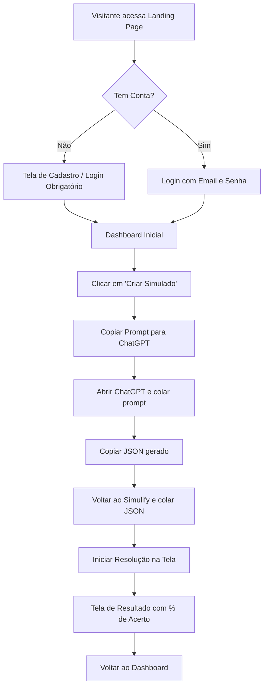
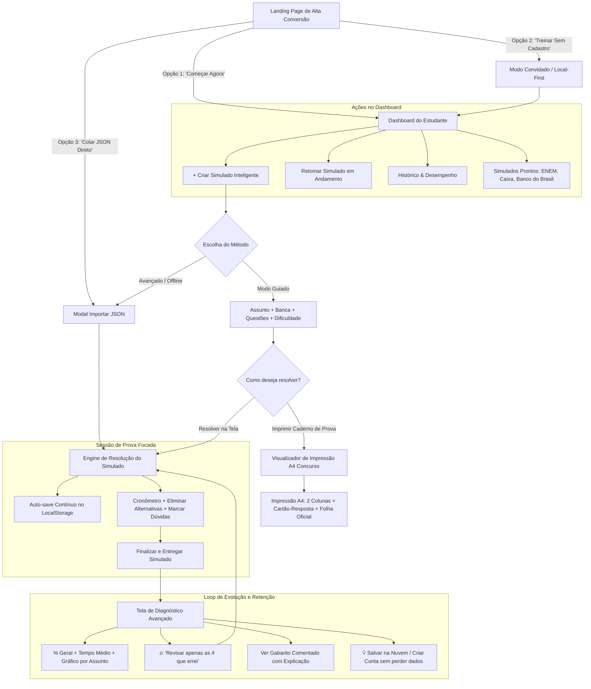

# UX_FLOWCHART.md — Análise Crítica e Evolução dos Fluxos do Simulify

Este documento detalha o processo de desenho do fluxo de navegação do usuário no **Simulify**, contendo a versão inicial (V1), a avaliação crítica com pontuação de falhas, e a versão aperfeiçoada (V2) desenhada para máxima retenção, zero atrito e foco em aprovação em concursos/vestibulares.

---

## 1. Fluxograma Versão 1 (Modelo Inicial Tradicional)

---

## 2. Leitura Crítica & Avaliação do Fluxograma V1

### Nota histórica da hipótese inicial: 5,5 / 10

### O que está ERRADO no Fluxograma V1:
1. **Parede de Cadastro (Friction Wall):**
   - Forçar o usuário a cadastrar email e senha antes mesmo de ver o produto funcionando gera taxa de abandono superior a 60% em ferramentas de estudo.
2. **Ciclo Manual Burocrático de IA ("Ping-pong de desenvolvedor"):**
   - Exigir que o estudante copie um prompt, saia do site, abra o ChatGPT, torça para a IA formatar o JSON certo, copie de volta e cole é péssimo. Isso parece um painel interno de desenvolvedor para alimentar banco de dados, e não um produto acabado.
3. **Morte do Ciclo de Aprendizado (Dead-end Result):**
   - A tela de resultado apenas mostra "Você acertou 60%". Não há diagnóstico de pontos fracos, nem indicação de quais subtópicos revisar, nem opção de refazer apenas as erradas. O usuário fica perdido e fecha a aba.
4. **Sem Suporte a Treino Físico (Zero Modo Impressão):**
   - Não há opção de imprimir em formato de prova real (caderno A4 de concurso). O concurseiro que precisa treinar a caneta preta não é atendido.
5. **Risco de Perda de Dados:**
   - Se a aba fechar no meio da prova, o progresso é perdido.

---

## 3. Fluxograma Versão 2 (Modelo Otimizado de Alta Performance)

---

## 4. Avaliação e Pontos Fortes do Fluxograma V2

### Nota da hipótese de fluxo: não representa a implementação atual

### Por que o Fluxograma V2 é superior:
1. **Zero Fricção (Time-to-Value Imediato):** O usuário pode testar com 1 clique (usando simulados pré-carregados do ENEM ou colando seu próprio JSON) sem fornecer email ou cartão de crédito.
2. **Preservação de Dados (Local-First):** O MVP usa IndexedDB local, com fallback de compatibilidade. Sincronização entre dispositivos permanece no roadmap cloud.
3. **Bifurcação Digital vs. Impresso:** Atende perfeitamente aos dois perfis de estudantes (quem faz no notebook/tablet e quem treina com caderno impresso idêntico à Cespe/FGV/ENEM).
4. **Fechamento do Loop Pedagógico:** A tela de resultados não é um ponto final, mas sim um trampolim para ação imediata ("Revisar apenas as que errei"). Isso gera retenção orgânica e evolução real de notas.
5. **Ergonomia à Prova de Falhas:** Auto-save contínuo garante que nenhum estudante perca 2 horas de prova por fechamento acidental de aba.
